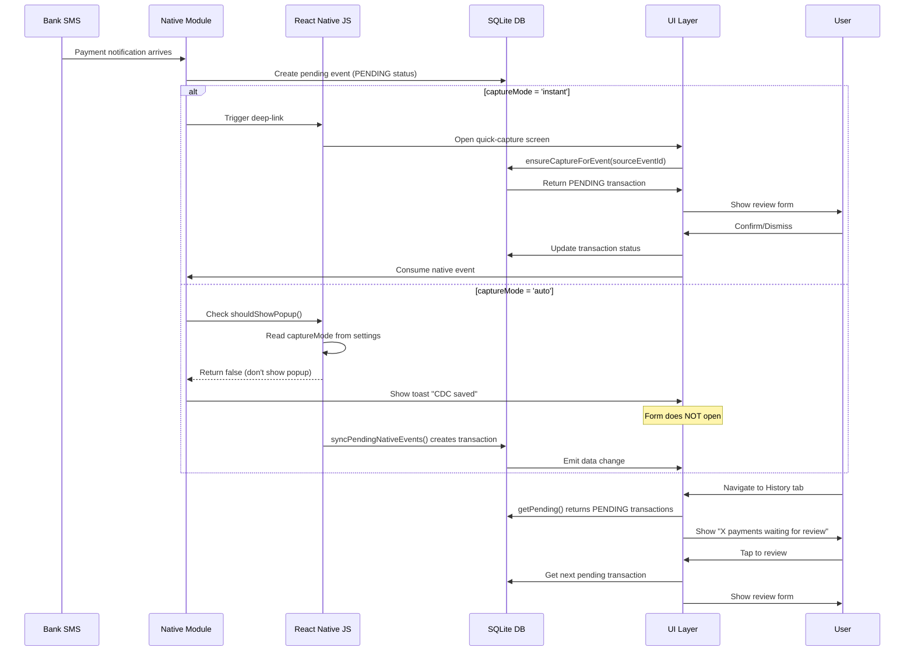

# Bug Fix + Capture Mode Feature Plan

## Problem Statement

### Bug: "Already reviewed" / "No reviews yet" on quick-capture screen

When a payment notification SMS arrives, the app sometimes shows "review has been done" / "no reviews yet" instead of the review form. This happens randomly, especially when another app is opened and then this app comes back up.

### Feature: Auto-Capture Mode Toggle

Add a toggle in settings for "auto-capture mode" vs "instant popup mode":
- **ON (auto mode)**: Bank SMS messages are silently stored as pending events with toast "CDC saved", form does NOT open instantly
- **OFF (instant mode, default)**: Current behavior preserved — review form opens instantly when message is received

---

## Root Cause Analysis

### The Race Condition

The bug is caused by a race condition between the foreground sync (`syncNative()` every 20s) and the deep-link handler (`ensureCaptureForEvent()`). Here's the sequence:

1. Payment SMS arrives → Native module creates a pending event in `moneymanager_notifications.db`
2. `CapturePopup.show()` opens quick-capture via deep-link: `moneymanager://quick-capture?sourceEventId=xxx`
3. Meanwhile, `syncNative()` (running every 20s or on app resume) calls `syncPendingNativeEvents()` which:
   - Calls `getPendingUpiEvents()` → returns all PENDING events from native DB
   - Creates app transactions via `createWithIdempotency()` for each event
   - **Does NOT consume native events** (consumption only happens when user confirms/dismisses in quick-capture)
4. When `ensureCaptureForEvent(sourceEventId)` is called by quick-capture:
   - It checks `getBySourceEventId(sourceEventId)` → finds the existing transaction
   - **Returns ANY existing transaction regardless of status** — if the transaction was previously created and reviewed (status='CONFIRMED'), it still returns it
5. In `quick-capture.tsx`:
   - `startId` is set to the existing transaction's ID (which may be CONFIRMED)
   - `getPending()` only returns PENDING transactions → `current` is null
   - The empty state "Already reviewed" is shown

### Why It's Random

The race condition only manifests when:
- A previous transaction with the same `sourceEventId` exists but has status other than 'PENDING'
- This happens when: user dismisses a transaction → native event is dismissed → later, the native event is re-ingested from SMS inbox (via `scanSmsInbox()`) → a new transaction is created by sync → but the old transaction still exists with CONFIRMED/DISMISSED status

### Key Code Locations

| File | Function | Issue |
|------|----------|-------|
| [`src/services/index.ts:222-235`](src/services/index.ts:222) | `ensureCaptureForEvent()` | Returns ANY existing transaction regardless of status |
| [`src/database/repositories/transactionRepository.ts:123-131`](src/database/repositories/transactionRepository.ts:123) | `getBySourceEventId()` | No status filtering |
| [`app/quick-capture.tsx:51-61`](app/quick-capture.tsx:51) | `fetcher` | Uses `startId` without verifying transaction is PENDING |
| [`app/_layout.tsx:114-125`](app/_layout.tsx:114) | `AppState.addEventListener('change')` | Triggers sync on app resume, which can create transactions before deep-link handler runs |

---

## UI Critique (Impeccable Skill)

### Design System Overview

The app uses a "Paper & Ink" theme with:
- Light/dark modes via [`src/design/theme.tsx`](src/design/theme.tsx)
- `makeStyles` and `useTheme` hooks for theming
- Flat design (no shadows, no gradients)
- Inter font family (400Regular, 600SemiBold)

### Existing Settings Screen Analysis

**Current structure:**
1. **Organize** section: Budgets, Recurring payments, People & splits, Categories, Monthly recap
2. **Appearance** section: Theme selector
3. **Privacy & security** section: App lock with timeout
4. **Notifications** section: Budget alerts, Bill reminders, Monthly recap
5. **Backup & data** section: Back up now, Restore from backup, Export as CSV
6. **Home screen widget** (Android only)
7. **Developer** section (dev only)

### CaptureStatusCard Component Analysis

The `CaptureStatusCard` component already exists and shows:
- Auto-capture status (on/off/unsupported)
- Steps to enable background popups
- Missed notification alerts

### Design Deficiencies Found

1. **Missing "Background capture" settings section**: The toggle for auto vs instant mode should be in a dedicated section between "Notifications" and "Backup & data", not buried inside CaptureStatusCard.

2. **No toast/notification feedback for silent mode**: When auto-mode is ON, the user needs clear feedback ("CDC saved") without opening the form. This requires a new toast implementation.

3. **Settings screen has no visual grouping for capture behavior**: The current settings screen lacks a section that groups SMS access, auto-capture toggle, and popup behavior settings together.

4. **No empty state guidance for history tab**: In auto-mode, users need to review pending payments from the History tab. The History screen needs a "X UPI payments waiting for review" button that doesn't exist yet.

### Recommendations

- Add a new section called "Background capture" between "Notifications" and "Backup & data"
- Use existing `Switch` component from `@/components/ui` for the toggle
- Reuse `CaptureStatusCard` as a visual indicator within this section
- Add toast notification via `useToast()` hook for silent saves

---

## Implementation Plan

### Phase 1: Bug Fix (Race Condition)

#### 1.1 Fix `ensureCaptureForEvent()` to filter by PENDING status

**File**: [`src/services/index.ts`](src/services/index.ts:222)

**Change**: Modify the function to only return transactions with `status='PENDING'` and `is_pending_capture=1`.

```typescript
async ensureCaptureForEvent(sourceEventId: string): Promise<Transaction | null> {
  const existing = await transactionRepository.getBySourceEventId(sourceEventId);
  if (existing) {
    // Only return if still pending — user may have already reviewed this event
    if (existing.status === 'PENDING' && existing.is_pending_capture === 1 && existing.is_dismissed === 0) {
      return existing;
    }
    return null; // Already reviewed or dismissed
  }
  await notificationDetectionService.initialize();
  const event = await notificationDetectionService.getPendingUpiEvent(sourceEventId);
  if (!event || event.status !== 'PENDING') return null;
  try {
    return (await transactionRepository.createWithIdempotency(captureInput(event))).transaction;
  } catch (error) {
    console.warn('[Capture] Create raced with sync:', error);
    return transactionRepository.getBySourceEventId(sourceEventId);
  }
}
```

#### 1.2 Add validation in quick-capture.tsx

**File**: [`app/quick-capture.tsx`](app/quick-capture.tsx:51)

**Change**: After getting `startId`, verify the transaction is still PENDING before using it.

```typescript
const fetcher = useCallback(async () => {
  let startId = params.id ?? null;
  if (!startId && params.sourceEventId) {
    const tx = await transactionService.ensureCaptureForEvent(params.sourceEventId);
    startId = tx?.id ?? null;
  }
  // Additional validation: verify startId transaction is still PENDING
  if (startId) {
    const currentTx = await transactionRepository.getById(startId);
    if (!currentTx || currentTx.status !== 'PENDING' || currentTx.is_pending_capture !== 1 || currentTx.is_dismissed === 1) {
      startId = null; // Transaction is no longer pending, fall back to queue
    }
  }
  const pending = await transactionRepository.getPending();
  return { queue: pending.map((t) => t.id).reverse(), startId };
}, [params.id, params.sourceEventId]);
```

### Phase 2: Capture Mode Setting

#### 2.1 Add `captureMode` to SettingsShape

**File**: [`src/services/settings.ts`](src/services/settings.ts:11)

**Changes**:
1. Add new type and key:

```typescript
export type CaptureMode = 'instant' | 'auto';

export interface SettingsShape {
  // ... existing fields ...
  /** How bank SMS notifications are handled: 'instant' opens review form, 'auto' saves silently */
  captureMode: CaptureMode;
}
```

2. Add default value:

```typescript
const DEFAULTS: SettingsShape = {
  // ... existing defaults ...
  captureMode: 'instant', // Default to current behavior
};
```

#### 2.2 Database Migration (Schema v6 → v7)

**File**: [`src/database/schema.ts`](src/database/schema.ts:136)

**Changes**:
1. Increment `SCHEMA_VERSION` from 6 to 7
2. Add migration SQL for `app_settings` table:

```typescript
// Migration from v6 to v7 - add captureMode column to app_settings
migrateV6ToV7: `
  -- Add captureMode setting with default value 'instant'
  INSERT OR IGNORE INTO app_settings (key, value) 
  VALUES ('captureMode', '"instant"')
`,
```

**File**: [`src/database/db.ts`](src/database/db.ts)

**Changes**: Add call to `migrateV6ToV7` in the migration chain.

### Phase 3: Wire captureMode into Layout

#### 3.1 Read captureMode on mount and skip deep-link navigation when auto

**File**: [`app/_layout.tsx`](app/_layout.tsx:108)

**Changes**:
1. Import `getSetting` for reading captureMode
2. Modify notification tap handler to check captureMode before navigating

```typescript
// In the Root() useEffect
useEffect(() => {
  if (state !== 'ready') return;
  void initNotifications().then(refreshScheduledNotifications);
  void syncWidget();

  // Read capture mode once on mount
  getSetting('captureMode').then((mode) => {
    setCaptureMode(mode);
  });

  // ... rest of existing code ...
}, [state]);
```

3. Modify `urlFromResponse` to skip navigation in auto mode:

```typescript
const handleNotificationUrl = useCallback(async (response: Notifications.NotificationResponse | null | undefined) => {
  const url = urlFromResponse(response);
  if (!url) return;
  
  // In auto mode, don't navigate to quick-capture — just show a toast
  if (captureMode === 'auto') {
    // Show toast notification instead of navigating
    Toast.show('CDC saved'); // Pseudo-code, see Phase 4
    return;
  }
  
  openUrl(url);
}, [captureMode]);
```

4. Replace the notification listener:

```typescript
const tapSub = Notifications.addNotificationResponseReceivedListener((response) => {
  handleNotificationUrl(response);
});
```

### Phase 4: Wire captureMode into Native Module

#### 4.1 Modify CapturePopup.kt to skip deep-link in auto mode

**File**: [`modules/notification-detection/android/src/main/java/com/moneymanager/notification/sms/CapturePopup.kt`](modules/notification-detection/android/src/main/java/com/moneymanager/notification/sms/CapturePopup.kt)

**Change**: The native module should NOT open the deep-link when in auto mode. Instead, it should just store the event silently.

However, since the native module cannot directly read React Native settings, we need to pass the captureMode from the JS layer. Here's the approach:

1. Add a new method to the native module that checks if captureMode is 'auto':
   
   **File**: [`modules/notification-detection/android/src/main/java/com/moneymanager/notification/module/MoneyManagerNotificationDetectionModule.kt`](modules/notification-detection/android/src/main/java/com/moneymanager/notification/module/MoneyManagerNotificationDetectionModule.kt)

2. Add a JS-side function that the SMS receiver calls:

```typescript
// In src/services/notificationDetection.ts
async shouldShowPopup(): Promise<boolean> {
  const mode = await getSetting('captureMode');
  return mode === 'instant';
}
```

3. Modify the SMS receiver to call `shouldShowPopup()` before triggering the deep-link:

**File**: [`modules/notification-detection/android/src/main/java/com/moneymanager/notification/sms/SmsReceiver.kt`](modules/notification-detection/android/src/main/java/com/moneymanager/notification/sms/SmsReceiver.kt)

The native SMS receiver currently calls `CapturePopup.show()` directly. We need to:
- Add a JS callback that the native module can call before showing the popup
- Check `captureMode` in JS and return whether to show the popup

### Phase 5: Settings UI

#### 5.1 Add "Background capture" section to settings.tsx

**File**: [`app/(tabs)/settings.tsx`](app/(tabs)/settings.tsx)

**Changes**:
1. Add `captureMode` to `Prefs` type:

```typescript
type Prefs = Pick<
  SettingsShape,
  'appLockEnabled' | 'appLockTimeoutMs' | 'budgetAlertsEnabled' | 'billRemindersEnabled' | 'recapEnabled' | 'lastBackupAt' | 'overallBudgetPaise' | 'captureMode'
>;
```

2. Add `captureMode` to `fetchSettings`:

```typescript
getSettings([
  'appLockEnabled',
  'appLockTimeoutMs',
  'budgetAlertsEnabled',
  'billRemindersEnabled',
  'recapEnabled',
  'lastBackupAt',
  'overallBudgetPaise',
  'captureMode',  // NEW
]),
```

3. Add new section between "Notifications" and "Backup & data":

```typescript
<Text variant="overline" style={styles.groupLabel}>
  Background capture
</Text>
<Card padded={false} style={styles.group}>
  <ListRow
    title="Auto-capture mode"
    subtitle="Save payments silently without opening the review form"
    left={<IconTile icon="zap" />}
    right={
      <SegmentedControl
        options={[
          { value: 'instant', label: 'Instant' },
          { value: 'auto', label: 'Auto' },
        ]}
        value={prefs?.captureMode ?? 'instant'}
        onChange={(v) => void updatePref('captureMode', v as CaptureMode)}
      />
    }
  />
</Card>
```

4. Keep `CaptureStatusCard` where it is (at the top of settings) for visual status indicator.

### Phase 6: History Tab Enhancement

#### 6.1 Add "X UPI payments waiting for review" button to transactions.tsx

**File**: [`app/(tabs)/transactions.tsx`](app/(tabs)/transactions.tsx)

**Changes**:
1. In the header, show a count of pending captures
2. Add a pressable row that navigates to quick-capture with `sourceEventId` filter

```typescript
{data.pendingCount > 0 ? (
  <Pressable
    onPress={() => router.push('/quick-capture')}
    style={styles.pendingRow}
    accessibilityRole="button"
  >
    <Icon name="receipt" size={16} color={colors.brand} />
    <Text variant="labelStrong" color={colors.brand}>
      {data.pendingCount} UPI payment{data.pendingCount > 1 ? 's' : ''} waiting for review
    </Text>
  </Pressable>
) : null}
```

---

## Architecture Diagram



---

## File Changes Summary

| File | Change Type | Description |
|------|-------------|-------------|
| `src/services/settings.ts` | Modify | Add `captureMode` to SettingsShape + DEFAULTS |
| `src/database/schema.ts` | Modify | Increment SCHEMA_VERSION, add v6→v7 migration |
| `src/database/db.ts` | Modify | Call migrateV6ToV7 in migration chain |
| `src/services/index.ts` | Modify | Fix ensureCaptureForEvent to filter by PENDING |
| `app/_layout.tsx` | Modify | Read captureMode, skip navigation in auto mode |
| `app/quick-capture.tsx` | Modify | Validate startId is PENDING before using |
| `app/(tabs)/settings.tsx` | Modify | Add "Background capture" section with toggle |
| `app/(tabs)/transactions.tsx` | Modify | Show pending count + tap to review |
| `modules/notification-detection/android/.../SmsReceiver.kt` | Modify | Call JS shouldShowPopup() before opening popup |

---

## Testing Plan

### Bug Fix Verification
1. Send a payment SMS → verify form opens instantly (instant mode)
2. Dismiss the transaction → send another SMS for same merchant → verify new form opens
3. Switch to another app → come back → send SMS → verify form opens
4. Send SMS while app is in background → come back → verify pending count updates

### Capture Mode Verification
1. **Instant mode (default)**:
   - Send SMS → form opens instantly ✓
   - Dismiss → next SMS → form opens again ✓
   
2. **Auto mode**:
   - Send SMS → toast "CDC saved", no form opens ✓
   - Navigate to History tab → see "1 payment waiting for review"
   - Tap → form opens with the pending transaction
   - Confirm → next SMS → toast again, no form

3. **Toggle behavior**:
   - Switch from instant to auto while SMS are pending → pending count shows in History
   - Switch from auto to instant → next SMS opens form immediately

---

## Risks and Mitigations

| Risk | Mitigation |
|------|------------|
| Native module cannot read JS settings | Use JS callback `shouldShowPopup()` before opening popup |
| Sync creates transactions before deep-link handler runs | Bug fix ensures we only return PENDING transactions |
| User forgets to review in auto mode | History tab shows pending count + CaptureStatusCard shows missed alerts |
| Schema migration fails | Migration is idempotent (INSERT OR IGNORE) |

---

## Execution Order

1. **Bug Fix** (Phase 1) — fixes the race condition at its source
2. **Settings + Schema** (Phase 2) — adds the captureMode setting
3. **Layout Wiring** (Phase 3) — reads captureMode and skips navigation
4. **Native Wiring** (Phase 4) — prevents popup in auto mode
5. **Settings UI** (Phase 5) — adds toggle to settings screen
6. **History Enhancement** (Phase 6) — adds review queue access
7. **Typecheck + Lint** — final verification
