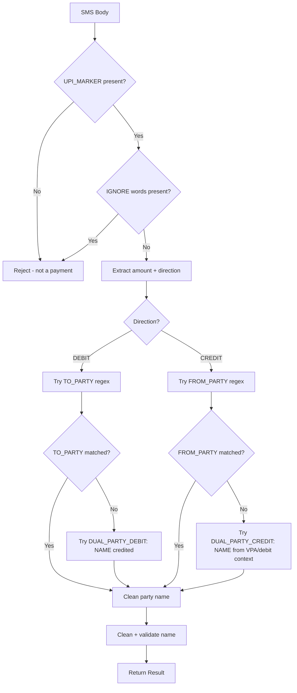

# Enhanced Bank SMS Parsing Plan

## Problem Statement

The current parser (`SmsUpiParser.kt` + `UpiMessageParser.kt`) only handles UPI-specific notification formats. Many bank SMS messages from ICICI Bank, Indian Bank, SBI and other Indian banks use different formats that include UPI backend transfers but don't follow the standard UPI notification syntax. These messages are silently dropped because they fail the `UPI_MARKER` gate or cannot extract a merchant name.

## Root Cause Analysis

### Issue 1: ICICI Dual-Party Format
**Sample:** `ICICI Bank Acct XX172 debited for Rs 625.00 on 08-Nov-26; TAMILAGA UNAVU credited. UPI:006743575869.`

| Field | Expected | What Happens | Why |
|-------|----------|--------------|-----|
| direction | DEBIT | DEBIT (correct) | "debited" appears before "credited" |
| amount | 62500 paise | 62500 (correct) | `Rs 625.00` matches AMOUNT regex |
| merchant | TAMILAGA UNAVU | **null** | TO_PARTY looks for `to [NAME]` but the name appears before "credited" after `;` |
| reference | 006743575869 | 006743575869 (correct) | `UPI:006743575869` matches REFERENCE |

**Root cause:** No regex for the dual-party pattern `[NAME]\s+credited` in debit context.

### Issue 2: Indian Bank "Sent Rs..." with merchant-RRN concatenation
**Sample:** `Sent Rs.400.00 from A/c *1224 on 07-11-26 to Radiance CINEMA.RRN 006712871613.Avl Bal Rs.6177.67.Not you?SMS BLOCK to 9289592895-Indian Bank`

| Field | Expected | What Happens | Why |
|-------|----------|--------------|-----|
| direction | DEBIT | DEBIT (correct) | "Sent" matches DEBIT, no CREDIT words |
| amount | 40000 paise | 40000 (correct) | `Rs.400.00` matches AMOUNT |
| merchant | Radiance CINEMA | **possibly null or partial** | TO_PARTY captures up to END which includes `.`, but the non-greedy NAME may stop too early |
| reference | 006712871613 | 006712871613 (likely correct) | `RRN 006712871613` matches REFERENCES |

**Root cause:** The merchant name is immediately followed by `.RRN` without space. The END pattern includes `[.,;()\[\n]` which should stop the capture at `.`, but the non-greedy NAME quantifier `{1,40}?` may match too few characters.

### Issue 3: Indian Bank "credited by" with RRN
**Sample:** `Your A/c *1224 is credited with Rs.60.00 on 27-10-26 by RUKSHATH T. RRN 006320782490.`

| Field | Expected | What Happens | Why |
|-------|----------|--------------|-----|
| direction | CREDIT | CREDIT (correct) | "credited" matches CREDIT |
| amount | 6000 paise | 6000 (correct) | `Rs.60.00` matches AMOUNT |
| merchant | RUKSHATH T | **possibly null** | FROM_PARTY `\b(?:from|by)\s+NAME$END` — "by RUKSHATH T" then `. RRN` — the `.` should trigger END |
| reference | 006320782490 | 006320782490 (correct) | `RRN 006320782490` matches |

**Root cause:** The honorific prefix stripping might remove too much or the NAME pattern may not handle short names with initials well.

### Issue 4: ICICI "credited from Mr" format
**Sample:** `Dear Customer, Acct XX172 is credited with Rs 30.00 on 03-Apr-26 from Mr Arnav Astu. UPI:645934930351.`

| Field | Expected | What Happens | Why |
|-------|----------|--------------|-----|
| direction | CREDIT | CREDIT (correct) | "credited" matches CREDIT |
| amount | 3000 paise | 3000 (correct) | `Rs 30.00` matches AMOUNT |
| merchant | Arnav Astu | **possibly null** | FROM_PARTY with HONORIFIC should strip "Mr" |
| reference | 645934930351 | 645934930351 (correct) | `UPI:645934930351` matches |

### Issue 5: NPCI BHIM credit
**Sample:** `Your A/c *1224 is credited with Rs.2.00 on 19-08-26 by NPCI BHIM. RRN 103878964445.`

| Field | Expected | What Happens | Why |
|-------|----------|--------------|-----|
| direction | CREDIT | CREDIT (correct) | "credited" matches CREDIT |
| amount | 200 paise | 200 (correct) | `Rs.2.00` matches AMOUNT |
| merchant | NPCI BHIM | **null** | cleanParty may reject "NPCI BHIM" — it's a system-level credit, not a person name. The NOT_A_NAME pattern doesn't catch it directly, but the length check (min 2 chars) passes. This might actually parse correctly at the native level. |

## Design: New Parser Architecture



## Changes Required

### File 1: `SmsUpiParser.kt` — Add dual-party patterns

Add two new regex patterns:

```kotlin
// For ICICI format: "debited for Rs 625; TAMILAGA UNAVU credited"
private val DUAL_PARTY_DEBIT = Regex(
    """;\s+($NAME)\s+credited""", I
)

// For Indian Bank format: "debited for Rs 625 for TAMILAGA UNAVU"
// (alternative where merchant appears after "for" in debit context)
private val FOR_MERCHANT = Regex(
    """\bfor\s+($NAME)$END""", I
)
```

In the `counterparty()` function, add fallback chains:

```kotlin
private fun counterparty(text: String, direction: Direction, slashName: String?): String? {
    // 1. Slash-format name (UPI/DR/...)
    cleanParty(slashName)?.let { return it }
    
    // 2. VPA-based extraction
    VPA.find(text)?.groupValues?.get(1)?.let { return it.lowercase() }
    
    val raw = when (direction) {
        Direction.DEBIT -> TO_PARTY.find(text)?.groupValues?.get(1)
            ?: DUAL_PARTY_DEBIT.find(text)?.groupValues?.get(1)  // NEW
            ?: FOR_MERCHANT.find(text)?.groupValues?.get(1)       // NEW
        Direction.CREDIT -> FROM_PARTY.find(text)?.groupValues?.get(1)
            ?: DUAL_PARTY_CREDIT.find(text)?.groupValues?.get(1) // NEW
    }
    return cleanParty(raw)
}
```

### File 2: `SmsUpiParser.kt` — Relax UPI marker for Indian Bank format

The current `UPI_MARKER` requires specific patterns. Add support for messages that have a valid RRN (10+ digit reference number) even without explicit "UPI" or "RRN" labels:

```kotlin
// Current UPI_MARKER already handles RRN 12-digit pattern
// But we need to also match when RRN is preceded by a dot (merchant.RRN)
private val ENHANCED_UPI_MARKER = Regex(
    """\bUPI\b|\bVPA\b|\b(?:RRN|Ref(?:erence)?\.?\s*(?:No\.?)?)\s*[:#\-]?\s*\d{10,}\b|[\w.\-]+@(?:ok(?:axis|sbi|hdfcbank|icici)|ybl|ibl|axl|paytm|apl|upi|fbl)\b|\bRRN\s+\d{10,}\b""",
    I
)
```

### File 3: `SmsUpiParser.kt` — Fix TO_PARTY for concatenated merchant.RRN

The TO_PARTY pattern needs to handle the case where the merchant name is followed by `.RRN` without space. The current END pattern already includes `.` as a termination character, but the non-greedy NAME quantifier `{1,40}?` may need adjustment:

```kotlin
// Change from non-greedy to possessive-like behavior
// Use a negative lookahead to exclude known suffixes
private val TO_PARTY = Regex(
    """\b(?:trf\s+to|transfer(?:red)?\s+to|to)\s+$HONORIFIC([A-Za-z][A-Za-z0-9 .&'\-]+?)(?=\.?\s*(?:RRN|UTR|Ref|txn|UPI|avl|bal|not|sms)\b)""",
    I
)
```

### File 4: `UpiMessageParser.kt` — Add dual-party patterns

The `UpiMessageParser` is used as a fallback by `SmsIngest` for general parsing. Add the same dual-party patterns there:

```kotlin
private val DUAL_PARTY_DEBIT = Regex(
    """[;.;]\s+([A-Za-z][A-Za-z0-9 .&'\-]{2,40}?)\s+credited""", I
)

private val DUAL_PARTY_CREDIT = Regex(
    """[;.;]\s+debited\s+for\s+[A-Z]+\s+[A-Za-z0-9.,\-]+\s+on\s+\d{2}-[A-Za-z]{3}-\d{2}\s*;?\s*([A-Za-z][A-Za-z0-9 .&'\-]{2,40}?)\s+credited""", I
)
```

### File 5: `UpiMessageParserTest.kt` — Add test cases for all sample messages

Add comprehensive test cases covering every sample message provided.

## Updated Todo List

1. Update SmsUpiParser.kt with dual-party DEBIT pattern (`NAME credited`)
2. Update SmsUpiParser.kt with enhanced TO_PARTY using lookahead for `.RRN` boundary
3. Update SmsUpiParser.kt with relaxed UPI marker (accept `RRN \d{10,}` without label prefix)
4. Update UpiMessageParser.kt with matching dual-party patterns
5. Update UpiMessageParser counterparty extraction logic
6. Add unit tests for all 9 sample messages in UpiMessageParserTest.kt
7. Add unit tests for SmsUpiParserTest.kt with Indian Bank and ICICI formats
8. Run tests and verify all samples parse correctly

## Expected Parsing Results After Fix

| # | Sample Message | Direction | Amount | Merchant | Reference |
|---|----------------|-----------|--------|----------|-----------|
| 1 | ICICI: `TAMILAGA UNAVU credited` | DEBIT | 62500 | TAMILAGA UNAVU | 006743575869 |
| 2 | ICICI: `VENKATESH A M credited` | DEBIT | 169500 | VENKATESH A M | 006723958737 |
| 3 | ICICI: `Pothys Madurai credited` | DEBIT | 36800 | Pothys Madurai | 006591114305 |
| 4 | ICICI: duplicate of #3 | DEBIT | 36800 | Pothys Madurai | 006591114305 |
| 5 | Indian Bank: `to Radiance CINEMA.RRN` | DEBIT | 40000 | Radiance CINEMA | 006712871613 |
| 6 | Indian Bank: `to MYJIO.RRN` | DEBIT | 21900 | MYJIO | 887100482194 |
| 7 | Indian Bank: `credited by RUKSHATH T` | CREDIT | 6000 | RUKSHATH T | 006320782490 |
| 8 | Indian Bank: `to Ms Dhanyataa.RR` | DEBIT | 4600 | Ms Dhanyataa | 205318847947 |
| 9 | Indian Bank: `by NPCI BHIM.RRN` | CREDIT | 200 | NPCI BHIM | 103878964445 |
| 10 | ICICI: `from Mr Arnav Astu.UPI` | CREDIT | 3000 | Arnav Astu | 645934930351 |
| 11 | ICICI: `from Mr P N Megaraja.UPI` | CREDIT | 18400 | P N Megaraja | 605208731014 |
